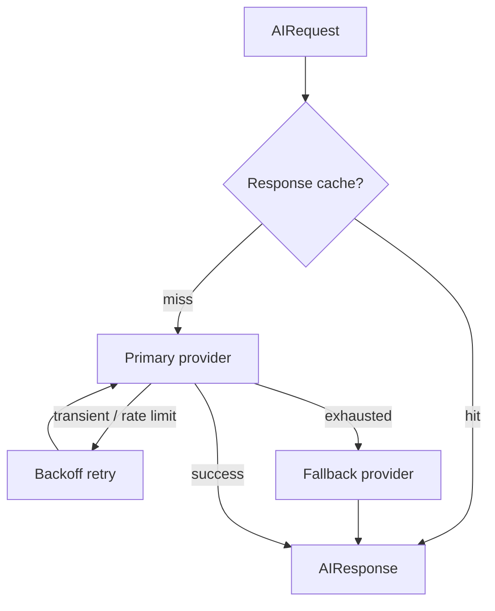

# AI Gateway

`refactory.ai.gateway.AIGateway` is provider-agnostic.

## Features

- Retries with exponential backoff
- Optional fallback provider
- Health checks + capability discovery
- Usage / cost estimation
- Optional response cache (`CACHE_AI_RESPONSES`)
- `last_cache_hit` for CLI indicators

## Flow

## Providers

| Name | Env | Module |
|------|-----|--------|
| `mock` | default | `ai.providers.mock` |
| `gemini` | `GEMINI_API_KEY` | `ai.providers.gemini` |
| `openai` | `OPENAI_API_KEY` | `ai.providers.openai` |

Factory: `build_ai_provider` / `build_ai_provider_pair` take `AISettings`.
