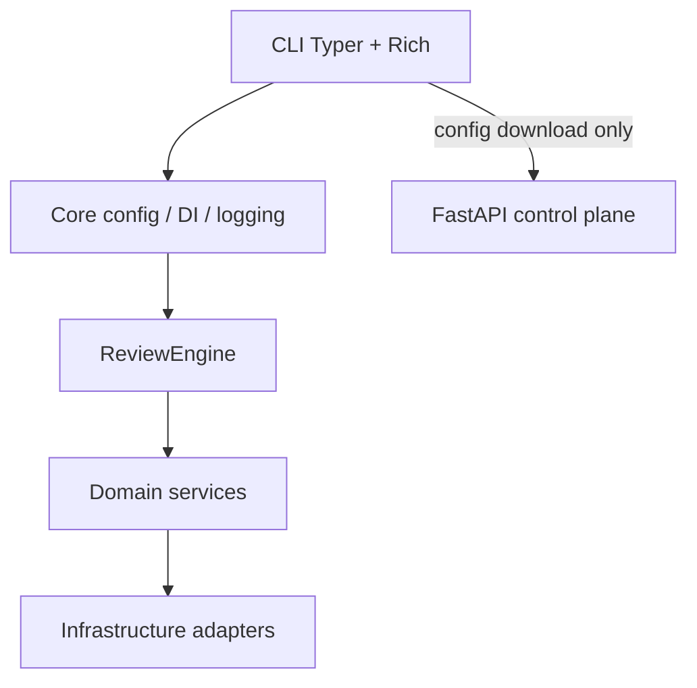

# Architecture Overview

Refactory is a **local-first** repository intelligence CLI with an optional FastAPI control plane.

## Dependency direction

Rules:

- CLI is presentation only — no business logic.
- Business packages must never import `refactory.cli`.
- `ReviewEngine` receives dependencies via constructor injection.
- The backend never receives repository source code.

## Package map

| Package | Role |
|---------|------|
| `refactory.cli` | Typer commands + Rich UI |
| `refactory.core` | Settings groups, DI container, Loguru |
| `refactory.review` | ReviewEngine, ports, engine `ReviewResult` |
| `refactory.git` / `github` | Local Git + optional GitHub PR fetch |
| `refactory.parser` / `indexer` | AST parse + deterministic index |
| `refactory.graph` | Knowledge graph from index |
| `refactory.embedding` / `retrieval` | Vectors + semantic/hybrid search |
| `refactory.prompt` | PromptBuilder + budgets |
| `refactory.ai` | AIGateway + providers |
| `refactory.response` | ResponseParser (ReviewResult / PartialReviewResult) |
| `refactory.backend` | Control-plane HTTP client |
| `refactory.cache` | Deterministic intelligent cache |
| `backend/refactory_backend` | FastAPI auth + config distribution |

## Configuration

Settings are nested groups loaded from flat env vars:

- `settings.ai.provider` ← `AI_PROVIDER`
- `settings.backend.url` ← `REFACTORY_BACKEND_URL`
- `settings.cache.enabled` ← `CACHE_ENABLED`
- `settings.prompt.max_tokens` ← `PROMPT_MAX_TOKENS`
- `settings.embedding.model` ← `EMBEDDING_MODEL`
- `settings.logging.level` ← `LOG_LEVEL`
