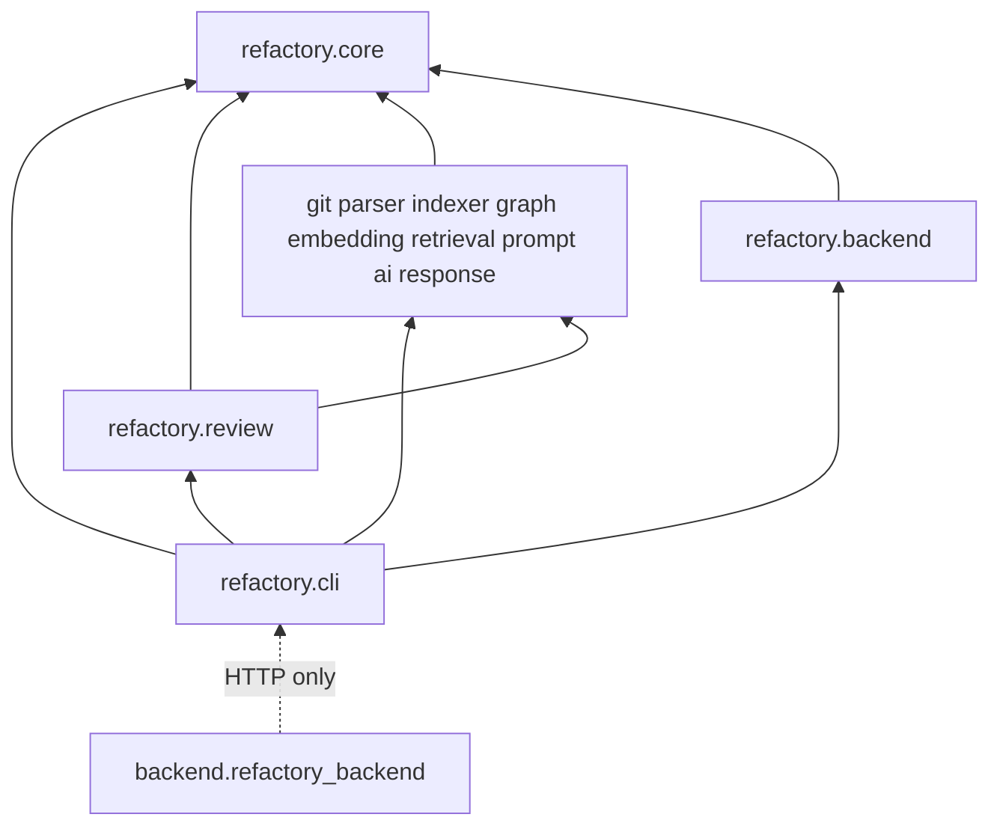

# Dependency Graph

## Allowed direction

## Forbidden

- `refactory.*` (non-cli) importing `refactory.cli`
- Backend importing CLI packages
- ReviewEngine importing concrete providers (uses ports / injected gateway)

Enforced in tests by `tests/unit/test_no_cli_imports_in_core.py`.
