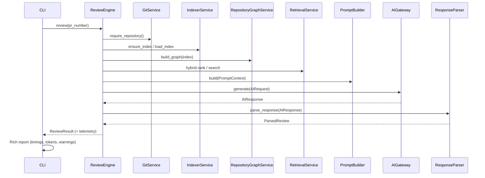

# Review Pipeline

## Sequence

## Stages

1. Resolve repository + PR (GitHub or local synthesis)
2. Ensure deterministic index
3. Build repository graph
4. Gather retrieval / hybrid context
5. Build prompt (no AI)
6. Generate via AIGateway
7. Parse response (never crashes on malformed AI text)
8. Map to engine `ReviewResult` with optional telemetry

`build_prompt()` runs stages 1–5 only (used by `refactory prompt`).
